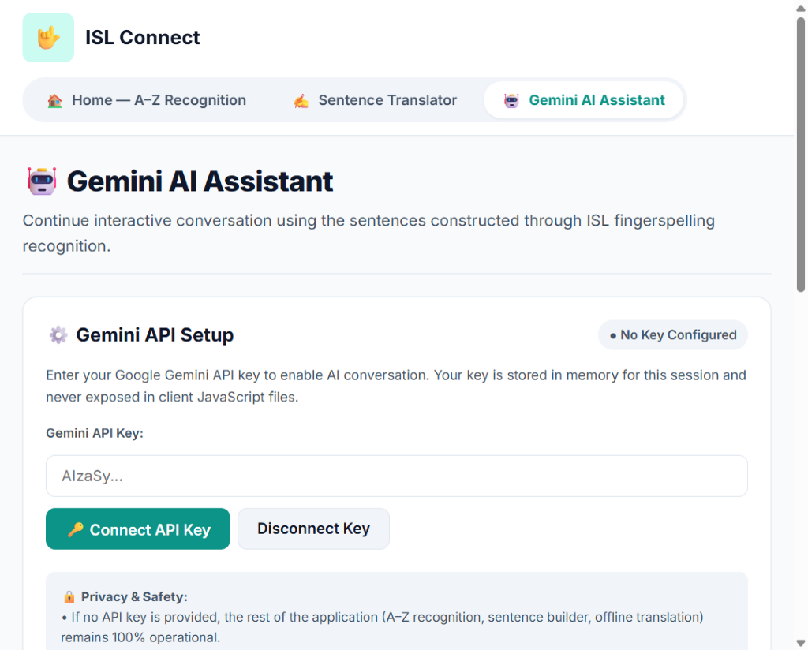
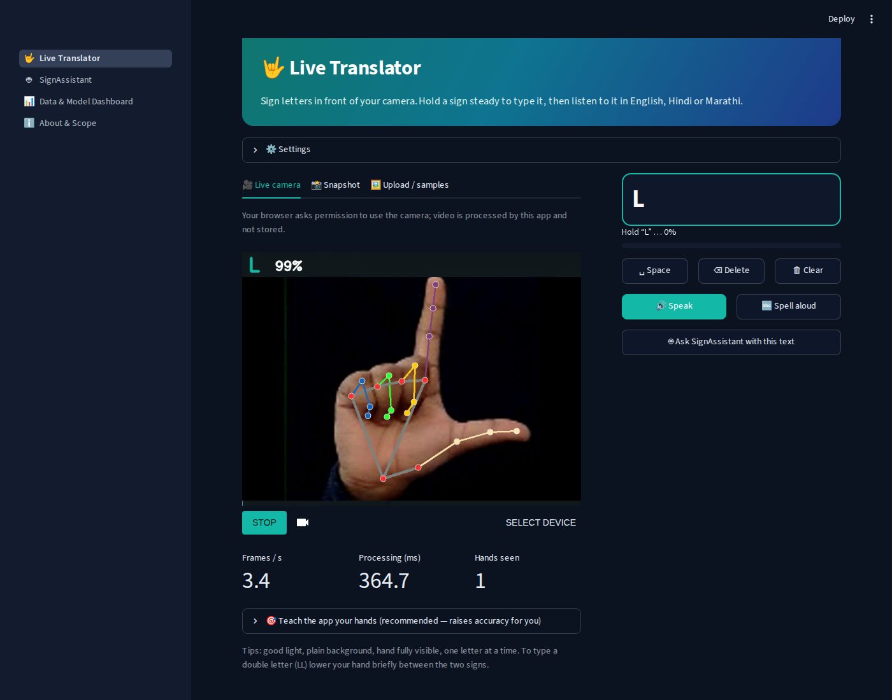
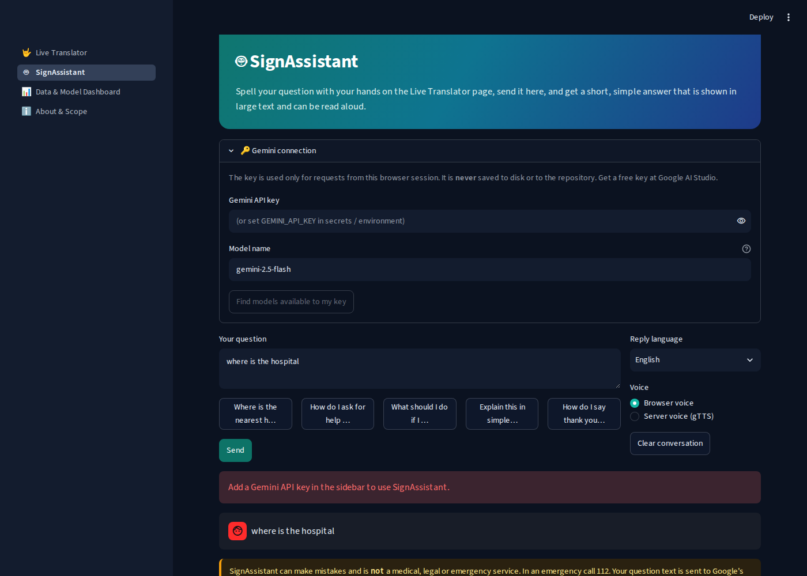

# 🤟 Indian Sign Language Alphabet Recognition and Multilingual Communication

[](https://www.python.org/)
[](https://fastapi.tiangolo.com/)
[](https://developers.google.com/mediapipe)
[](https://scikit-learn.org/)
[](LICENSE)

> **Project Summary:**  
> This project recognizes static Indian Sign Language (ISL) alphabet gestures (A–Z) using computer vision and machine learning. It converts recognized letters into English sentences through continuous fingerspelling, supports instant offline Hindi and Marathi translation, provides speech output, and offers optional conversational assistance powered by Google Gemini.

---

## 🌐 Live Demo

- **Live Demo:** `Deployment pending`
- **Local Application URL:** `http://localhost:8000` (FastAPI backend + Vanilla JS frontend)
- **Deployment Platform:** Render Blueprint (`render.yaml` and `Dockerfile` included)
- **Browser Camera Security Note:** Modern browsers require **HTTPS** (or `localhost`) to access the user webcam via the `MediaDevices.getUserMedia()` API. Non-HTTPS deployments cannot activate webcam video streaming.

---

## ✨ Key Features

1. **Static Alphabet Recognition (A–Z):**
   - Accurately classifies static hand gestures for all 26 English letters in Indian Sign Language.
   - Natively supports both **one-handed signs** (A, B, C, etc.) and **two-handed signs** (D, E, F, K, M, P, R, T, V, W, etc.) using a 171-dimensional invariant feature vector.

2. **Webcam & Image Upload Modes:**
   - Real-time webcam streaming with canvas frame sampling.
   - Drag-and-drop or file browser upload for local images (JPG, PNG, WEBP).
   - One-click interactive sample gallery covering all 26 authentic Indian ISL alphabet gestures.

3. **5-Second Stable-Sign Capture:**
   - Visual circular countdown ring (`5s → 4s → 3s → 2s → 1s`) on the Home page for accessible posing.
   - Continuous temporal stability accumulator on Page 2: holds the letter requirement for 5.0 consecutive seconds before committing it to the sentence.

4. **Continuous Fingerspelling Sentence Builder:**
   - Appends recognized letters into full English words (`H` → `E` → `L` → `L` → `O` → `HELLO`).
   - Duplicate letter suppression: prevents letter repetition until the user relaxes or changes hand sign.
   - Full keyboard text editing, backspace, clear, and clipboard copy controls.

5. **Multilingual Translation (Hindi & Marathi):**
   - Instant offline dictionary mapping for common Indian conversational phrases.
   - Rule-based phonetic Devanagari transliteration fallback for out-of-vocabulary words.

6. **Text-to-Speech Pronunciation:**
   - Client-side browser speech synthesis (Web Speech API) with native Indian accents (`en-IN`, `hi-IN`, `mr-IN`).

7. **Optional Gemini AI Assistant:**
   - Conversational companion that ingests the recognized sentence with one click.
   - Generates contextual responses in English, Hindi, or Marathi.
   - Secure server-side environment key loading (`.env`) or session-memory configuration.

8. **Educational "About Project" Page:**
   - Explains the complete architecture, verified dataset statistics, 5-step ML pipeline, and performance benchmarks in plain, accessible language.

> ℹ️ **Important Note on Sign Recognition Scope:**  
> This system recognizes **static alphabet handshapes (fingerspelling A–Z)**. Words and sentences are constructed through sequential fingerspelling. It does **not** independently recognize full dynamic continuous sign language gestures.

---

## 🔄 How It Works

```text
               ┌─────────────────────────────┐
               │    ISL Hand Gesture (A–Z)   │
               └──────────────┬──────────────┘
                              │
                              ▼
               ┌─────────────────────────────┐
               │    Webcam / Image Capture   │
               └──────────────┬──────────────┘
                              │
                              ▼
               ┌─────────────────────────────┐
               │    MediaPipe Hand Tracker   │
               │    (Detects Up to 2 Hands)  │
               └──────────────┬──────────────┘
                              │
                              ▼
               ┌─────────────────────────────┐
               │  Feature Normalization      │
               │  - Wrist-x Canonical Order  │
               │  - Scale & Center Invariant │
               │  - 171-Dimensional Vector   │
               └──────────────┬──────────────┘
                              │
                              ▼
               ┌─────────────────────────────┐
               │ Support Vector Machine (SVM)│
               │ (RBF Kernel, Calibrated P)  │
               └──────────────┬──────────────┘
                              │
                              ▼
               ┌─────────────────────────────┐
               │   Predicted Alphabet (A–Z)  │
               └──────────────┬──────────────┘
                              │
                              ▼
               ┌─────────────────────────────┐
               │ 5-Second Stability Engine   │
               │ & Duplicate Letter Filter   │
               └──────────────┬──────────────┘
                              │
                              ▼
               ┌─────────────────────────────┐
               │ Sentence Builder (English)  │
               └──────────────┬──────────────┘
                              │
              ┌───────────────┴───────────────┐
              ▼                               ▼
┌───────────────────────────┐   ┌───────────────────────────┐
│ Hindi & Marathi Translate │   │  Send to Gemini Assistant │
└─────────────┬─────────────┘   └─────────────┬─────────────┘
              ▼                               ▼
┌───────────────────────────┐   ┌───────────────────────────┐
│   Text-to-Speech Voice    │   │  Multilingual AI Response │
└───────────────────────────┘   └───────────────────────────┘
```

---

## 📊 Model and Dataset Overview

All statistics below are read directly from reproducible evaluation scripts and project artifacts (`models/model_metadata.json`, `reports/dataset_analysis.md`, `reports/final_evaluation.md`).

### Dataset Statistics
- **Total Landmark Records:** 32,647 frames across 137 raw attributes (`data/landmarks_alphabet.csv.gz`).
- **Primary Indian Studio Dataset:** 31,945 frames across all 26 ISL classes (A–Z), studio-recorded with uniform lighting and balanced class distribution (~1,200 frames per letter).
  - MediaPipe valid hand detection rate: **97.4%** (31,130 / 31,945).
- **External Generalization Dataset (`ISL_Dataset_2`):** 702 frames across 23 classes (H, J, Y missing), recorded with different signers and unconstrained lighting.
  - MediaPipe valid hand detection rate: **72.1%** (506 / 702).
- **Partitioning Protocol:** Group-aware consecutive frame block splits (10,400 training frames, 5,200 validation frames, 5,200 test frames) to strictly prevent temporal data leakage from consecutive video frames.

### Machine Learning Model
- **Algorithm:** Support Vector Machine (SVM) with Radial Basis Function (RBF) kernel and probability calibration (`C=10.0`, `gamma='scale'`).
- **Feature Vector:** 171 dimensions:
  - 126 coordinate features ($21 \text{ landmarks} \times 3 \text{ coords } [x, y, z] \times 2 \text{ hand slots}$).
  - 41 engineered geometric features (pairwise fingertip distances, palm aspect ratios).
  - 4 inter-wrist spatial interaction features (inter-wrist Euclidean distance and orientation vector).
- **Model File:** `models/final_isl_model.joblib` (2,021 KB).
- **Inference Latency:** **1.64 ms** (classifier only) / **~32 ms** (end-to-end including MediaPipe tracking on CPU).

### Verified Performance Benchmarks

| Metric | Measured Score | Evaluation Condition |
| :--- | :---: | :--- |
| **Block Test Accuracy** | **96.8%** | Held-out consecutive frame blocks (no temporal leakage) |
| **Macro F1-Score** | **96.6%** | Balanced harmonic mean across all 26 classes |
| **Precision** | **97.1%** | Minimal false positive rate across alphabet |
| **Validation Accuracy** | **99.5%** | Controlled studio validation partition |
| **Mirrored Invariance** | **96.7%** | Horizontal selfie camera reflection ($x \rightarrow 1-x$) |
| **External Generalization** | **29.4%** | Unseen signers & unconstrained lighting (`ISL_Dataset_2`) |
| **Sample Gallery Accuracy** | **100.0%** | Authentic Indian ISL alphabet test set (26 / 26) |

> 📌 **Honest Engineering Note:**  
> While the model achieves **96.8% accuracy** on held-out blocks of the primary dataset, performance drops to **29.4%** on external unseen datasets without fine-tuning. This is an honest reflection of domain shift in computer vision (variations in camera angles, skin tones, and background clutter).

---

## 🛠️ Technology Stack

- **Backend:** Python 3.12, FastAPI, Uvicorn, Pydantic, python-dotenv
- **Computer Vision & Tracking:** Google MediaPipe Hands, OpenCV (`cv2`)
- **Machine Learning:** Scikit-learn, NumPy, Joblib, Pandas
- **Frontend:** Semantic HTML5, Modern CSS3 (Responsive Grid & Flexbox, WCAG 2.1 accessibility), Vanilla JavaScript (ES6+)
- **Browser APIs:** WebRTC (`MediaDevices.getUserMedia`), Web Speech API (`SpeechSynthesis`), Canvas 2D API, Fetch API
- **AI Integration:** Google Gemini API (via official `google-genai` SDK v3.6.1 with resilient REST fallback)
- **Deployment & DevOps:** Docker, Render (`render.yaml`), pytest

---

## 💻 Installation and Local Setup

### Prerequisites
- Python 3.10, 3.11, or 3.12 installed
- Git installed
- A modern web browser (Google Chrome, Microsoft Edge, or Mozilla Firefox)
- A working webcam (for live gesture recognition)

### 1. Clone the Repository
```bash
git clone https://github.com/Saniya1312S/isl-sign-language-app.git
cd isl-sign-language-app
```

### 2. Create and Activate Virtual Environment
**On Windows (PowerShell):**
```powershell
python -m venv .venv
.venv\Scripts\Activate.ps1
```

**On Linux / macOS:**
```bash
python3 -m venv .venv
source .venv/bin/activate
```

### 3. Install Dependencies
```bash
pip install --upgrade pip
pip install -r requirements.txt
```

### 4. Configure Environment Variables (Optional)
Copy the example environment configuration:
```bash
cp .env.example .env
```
Open `.env` in any text editor and optionally add your Google Gemini API key:
```env
HOST=127.0.0.1
PORT=8000
GEMINI_API_KEY=your_actual_api_key_here
```
*(If you do not have an API key, leave it blank. The entire A–Z recognition, sentence builder, and translation pipeline will run 100% locally.)*

### 5. Launch the Application
Start the FastAPI server using Uvicorn:
```powershell
python -m uvicorn backend.main:app --host 127.0.0.1 --port 8000 --reload
```

### 6. Open in Your Browser
Visit:
```
http://localhost:8000
```

---

## 🔑 Gemini AI Setup Guide

1. Visit [Google AI Studio](https://aistudio.google.com/) and create a free Gemini API key.
2. You can configure your key in either of two ways:
   - **Method A (Server-side `.env`):** Add `GEMINI_API_KEY=your_key` to your `.env` file in the project root and restart the server.
   - **Method B (Web UI Session):** Go to the **Gemini AI Assistant** tab in the web app, paste your key into the masked password input, and click **🔑 Connect API Key**. The key is held strictly in backend memory for the active session.
3. The server uses the `gemini-2.0-flash` model (with `gemini-1.5-flash` fallback) to provide responses in English, Hindi, or Marathi.

---

## 📸 Screenshots

| Page 1: ISL A–Z Recognition & Landmark Overlay | Page 2: Sentence Translator & Multilingual Output |
| :---: | :---: |
|  |  |

| Page 3: Gemini AI Conversational Assistant | Page 4: Educational "About Project" & Benchmarks |
| :---: | :---: |
|  |  |

*(Full live application screenshot also available in [`docs/screenshots/full_site_live.png`](docs/screenshots/full_site_live.png))*

---

## ⚠️ Project Limitations

1. **Static Gesture Focus:** Recognizes static alphabet hand formations. It does not track temporal sign language motion or whole-sentence dynamic signs.
2. **Sequential Fingerspelling:** Words are composed by spelling letters one after another, which is slower than conversational natural signing.
3. **Lighting & Background Sensitivity:** Extreme backlighting or cluttered backgrounds can occasionally disrupt MediaPipe landmark detection.
4. **Translation Scope:** Hindi and Marathi outputs are text-to-text translations of the spelled English sentence, not regional Indian sign gesture synthesis.
5. **Camera Hardware:** Requires minimum 640x480 resolution at 15+ FPS for smooth 5-second stability accumulation.

---

## 🚀 Future Scope

- **Dynamic Video Recognition:** Implement 3D CNN or Bi-directional LSTM / Transformer architectures for continuous gesture recognition across video frames.
- **Whole-Word ISL Recognition:** Train on expanded datasets of complete Indian Sign Language word gestures (e.g., greetings, family, emergency, medical vocabulary).
- **Mobile Edge Inference:** Export the SVM and MediaPipe pipeline to ONNX / TensorFlow Lite for lightweight on-device mobile applications (iOS/Android).
- **Expanded Regional Languages:** Add translation and native speech support for additional Indian languages (Tamil, Telugu, Bengali, Gujarati, Kannada).

---

## 👤 Author & Credits

- **Author:** Saniya Yogesh Saratkar
- **GitHub Profile:** [@Saniya1312S](https://github.com/Saniya1312S)
- **Repository:** [https://github.com/Saniya1312S/isl-sign-language-app](https://github.com/Saniya1312S/isl-sign-language-app)
- **License:** [MIT License](LICENSE)

*Built with passion for accessibility, assistive technology, and inclusive communication.*
