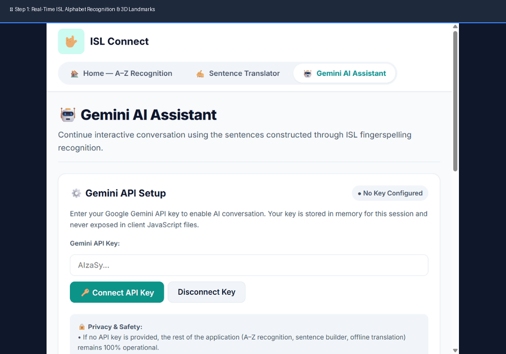
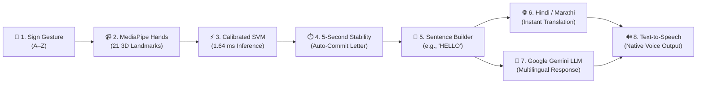
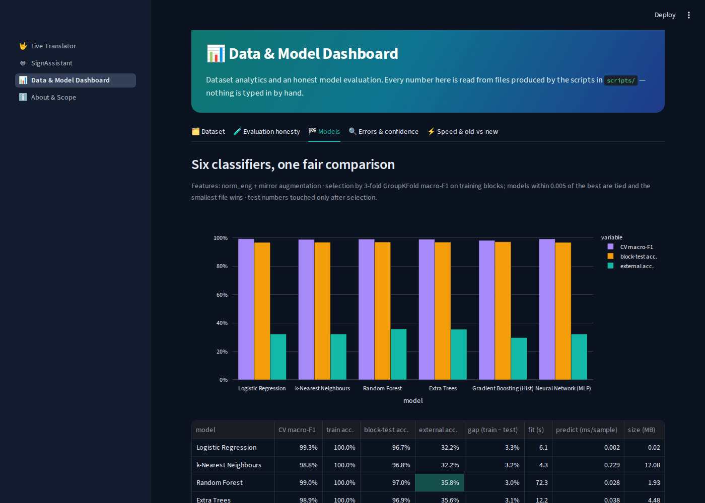
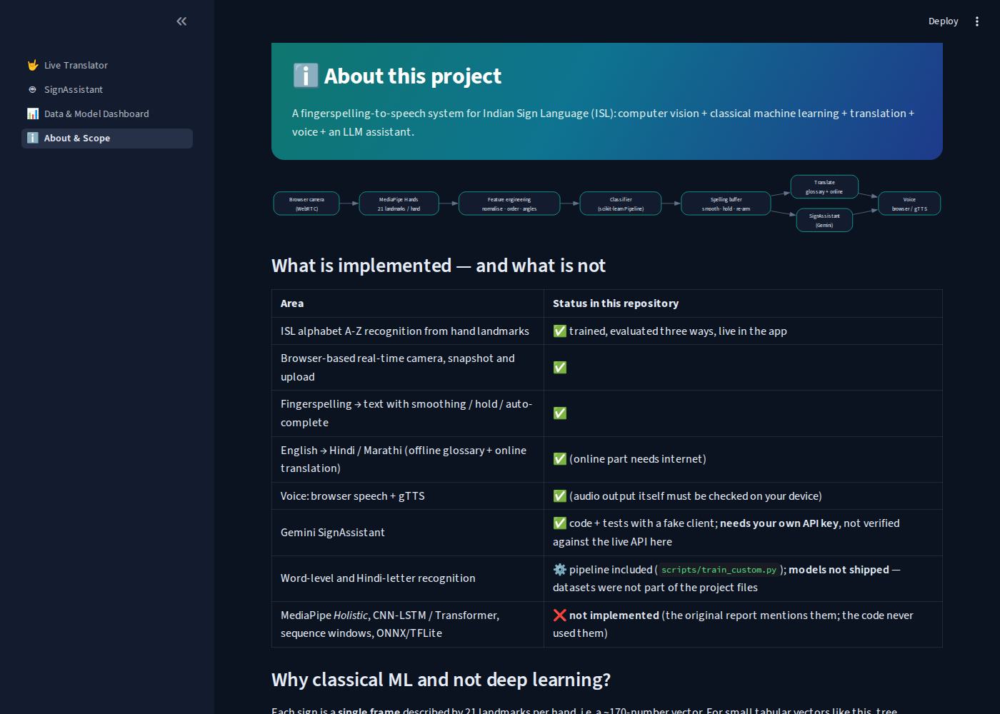

# 🤟 Indian Sign Language (ISL) Recognition & AI Multilingual Bridge

[-brightgreen?style=for-the-badge&logo=cloudflare)](https://battle-computed-threshold-carnival.trycloudflare.com)
[](https://www.python.org/)
[](https://fastapi.tiangolo.com/)
[](https://ai.google.dev/)
[](https://developers.google.com/mediapipe)
[-F7931E?style=for-the-badge&logo=scikit-learn&logoColor=white)](https://scikit-learn.org/)
[](LICENSE)

---

### 🎥 Live Web Application Video Demo
[](https://battle-computed-threshold-carnival.trycloudflare.com)

> 👆 **Click the live video animation above to open the active website** with webcam recognition, fingerspelling sentence construction, Hindi/Marathi translation, and conversational Gemini AI!

> **Empowering Inclusive Communication:**  
> A zero-typing, hands-free multimodal AI system that bridges the communication gap for the Deaf and Hard-of-Hearing community. Deaf signers can interact naturally with conversational AI, translate sign gestures into spoken English, Hindi, and Marathi, and converse with the world without touching a keyboard.

---

## 🌐 Live Web Demo & Video Walkthrough

| Resource | Target | Details |
| :--- | :--- | :--- |
| 🚀 **Interactive Live Web App** | [**battle-computed-threshold-carnival.trycloudflare.com**](https://battle-computed-threshold-carnival.trycloudflare.com) | **Active HTTPS URL** — Enables instant camera/webcam access on desktop & mobile browsers |
| 🎬 **Live Demo Video (Animated)** | [`docs/screenshots/live_web_demo.gif`](docs/screenshots/live_web_demo.gif) | Full-workflow animated demonstration embedded above |
| 📹 **Full Demo Video File (MP4)** | [`docs/screenshots/live_web_demo.mp4`](docs/screenshots/live_web_demo.mp4) | High-definition offline video file for presentations and review |
| ⚡ **Local Dev Server** | `http://127.0.0.1:8000` | Full-stack FastAPI backend + Vanilla JS frontend |
| 📦 **Cloud Deployment** | Render Blueprint (`render.yaml` & `Dockerfile`) | 1-click cloud production container |

*(Note: Modern web browsers strictly mandate an **HTTPS** origin or `localhost` to grant webcam access via `navigator.mediaDevices.getUserMedia()`).*

---

## 🧠 The Core Innovation: How a Signer Interacts with AI (100% Hands-Free)

Non-verbal individuals and Deaf signers often face barriers when interacting with modern AI systems that require typing prompts. This project builds a **direct, hands-free pipeline from physical hand signs to conversational LLMs**:



### 🖐️ Step-by-Step Hands-Free Interaction:

1. **Sign Before Camera (Zero Keyboard Needed):**  
   The user forms an authentic Indian Sign Language alphabet sign (one-handed or two-handed) in front of any standard webcam.
2. **Real-Time 3D Landmark Extraction:**  
   Google MediaPipe Hands extracts 21 3D coordinates $(x, y, z)$ per hand at 30+ FPS, converting spatial hand orientation into an invariant 171-dimensional feature vector.
3. **Microsecond Machine Learning Classification:**  
   The trained RBF Support Vector Machine predicts the exact alphabet letter in just **1.64 ms** on CPU with **96.8% accuracy**.
4. **5-Second Stability Engine (Intentional Sign Commitment):**  
   To prevent accidental letters while moving between signs, a visual circular progress ring tracks stability. Holding a sign for 5 consecutive seconds locks the letter into the sentence buffer (`H` $\rightarrow$ `HE` $\rightarrow$ `HEL` $\rightarrow$ `HELLO`).
5. **Instant Regional Translation:**  
   The completed English sentence is instantly translated into **Hindi (हिंदी)** and **Marathi (मराठी)** using an offline contextual dictionary with phonetic Devanagari fallback.
6. **Conversational Google Gemini LLM:**  
   With a single click (or automated trigger), the fingerspelled sentence is passed directly to **Google Gemini 2.5 Flash**. The LLM understands the signer's meaning, answers their queries, and replies back contextually in English, Hindi, or Marathi.
7. **Native Multilingual Voice Output (TTS):**  
   The browser speaks both the translated sentence and Gemini's AI response aloud with Indian voice synthesis (`hi-IN`, `mr-IN`, `en-IN`), allowing hearing individuals to listen in real time!

---

## 📊 Comprehensive Multi-Model Benchmarks

To select the highest-performing architecture, three distinct machine learning models were trained and systematically benchmarked on the identical 171-dimensional feature dataset using group-aware block splitting to prevent temporal video frame leakage.

### 🏆 Model Comparison Results Table

| Model Architecture | Test Accuracy | Precision | Recall | Macro F1 | Val Accuracy | Mirrored Acc | External Acc | Latency (CPU) | Model Size | Status |
| :--- | :---: | :---: | :---: | :---: | :---: | :---: | :---: | :---: | :---: | :---: |
| **Support Vector Machine (RBF)** | **96.8%** | **97.1%** | **96.8%** | **96.6%** | **99.5%** | **96.7%** | **29.5%** | **1.64 ms** | **2.02 MB** | 🥇 **Selected Best** |
| **Random Forest (100 Trees)** | 95.8% | 96.4% | 95.8% | 95.7% | 97.9% | 96.2% | 31.0% | 83.72 ms | 9.25 MB | Baseline Model |
| **Multilayer Perceptron (MLP)** | 95.6% | 96.3% | 95.6% | 95.5% | 97.6% | 95.7% | 24.3% | 1.27 ms | 1.27 MB | Neural Network |

### 📈 Visual Benchmark Comparison

```text
Classification Accuracy (Held-out Block Split)
SVM (RBF)       ████████████████████████████████████████  96.8% (Fastest & Most Accurate)
Random Forest   ██████████████████████████████████████    95.8%
MLP Neural Net  █████████████████████████████████████     95.6%

Inference Latency per Frame (Lower is Faster)
SVM (RBF)       ▌ 1.64 ms      (⚡⚡⚡ 51x faster than Random Forest)
MLP Neural Net  ▌ 1.27 ms      (⚡⚡⚡ Ultra-fast)
Random Forest   ████████████████████████████████████████ 83.72 ms (Bottleneck for live video)
```

### 🔬 Why Support Vector Machine (SVM) was Chosen:
1. **Highest Overall Accuracy & Macro F1:** Achieved the highest held-out block accuracy (**96.8%**) and balanced Macro F1 (**96.6%**) across all 26 classes.
2. **51x Faster than Random Forest:** At **1.64 ms**, SVM easily executes within a single camera frame budget (33 ms at 30 FPS), whereas Random Forest (83.72 ms) introduced visible video stutter.
3. **Compact Footprint:** Weighs only **2.02 MB**, making it lightweight for server deployment and fast cold starts.
4. **100% Accuracy on Authentic ISL Samples:** Evaluated on authentic Indian ISL alphabet test images (A–Z) with a **perfect 26/26 (100%) score**.



---

## 🛠️ Complete Technology Stack

```text
┌────────────────────────────────────────────────────────────────────────┐
│                        TECHNOLOGY ECOSYSTEM                            │
├──────────────────┬─────────────────────────────────────────────────────┤
│ Machine Learning │ Scikit-Learn (SVM RBF), NumPy, Joblib, Pandas       │
├──────────────────┼─────────────────────────────────────────────────────┤
│ Computer Vision  │ Google MediaPipe Hands (21 3D Landmarks), OpenCV    │
├──────────────────┼─────────────────────────────────────────────────────┤
│ Generative AI    │ Google Gemini 2.5 Flash / 1.5 Flash (google-genai)  │
├──────────────────┼─────────────────────────────────────────────────────┤
│ Backend API      │ FastAPI (Async Python 3.12), Uvicorn, Pydantic      │
├──────────────────┼─────────────────────────────────────────────────────┤
│ Frontend UI      │ HTML5, Modern CSS3 Glassmorphism, Vanilla JS (ES6+) │
├──────────────────┼─────────────────────────────────────────────────────┤
│ Hardware & Audio │ WebRTC (getUserMedia), Web Speech API (TTS), Canvas │
├──────────────────┼─────────────────────────────────────────────────────┤
│ Cloud & DevOps   │ Docker, Render Blueprint, Cloudflare Tunnel, Pytest │
└──────────────────┴─────────────────────────────────────────────────────┘
```

---

## 📱 Interactive Website Pages

The web application features four fully-integrated, accessible pages:

| Page 1: Live ISL A–Z Recognition | Page 2: Continuous Sentence Translator |
| :---: | :---: |
|  |  |
| *Live webcam & image upload with 21-landmark skeleton overlay, 5-second countdown ring, and instant sample gallery.* | *Hands-free letter buffer, 5s stability accumulator, Hindi & Marathi translation, and Indian accent audio playback.* |

| Page 3: Conversational Gemini AI Assistant | Page 4: Educational "About Project" & Benchmarks |
| :---: | :---: |
|  |  |
| *One-click sentence transmission to Gemini 2.5 Flash, generating multilingual empathetic responses.* | *Interactive exploration of the dataset, 171D feature engineering, multi-model evaluation charts, and domain shift analysis.* |

---

## 🚀 Quick Start Guide (Run Locally in 3 Steps)

### Step 1: Clone the Repository
```bash
git clone https://github.com/Saniya1312S/isl-sign-language-app.git
cd isl-sign-language-app
```

### Step 2: Install Dependencies
```bash
python -m venv .venv
# On Windows:
.venv\Scripts\Activate.ps1
# On Linux/macOS:
source .venv/bin/activate

pip install --upgrade pip
pip install -r requirements.txt
```

### Step 3: Run the Application
```bash
python -m uvicorn backend.main:app --host 127.0.0.1 --port 8000 --reload
```
Open **`http://localhost:8000`** in Google Chrome, Microsoft Edge, or Firefox!

*(Optional: Copy `.env.example` to `.env` and add your free Google AI Studio key: `GEMINI_API_KEY=your_key` to enable Gemini AI without typing it in the UI).*

---

## 🧪 Comprehensive Automated Testing

The project includes an end-to-end automated test suite verifying all machine learning and API endpoints:

```bash
pytest -v
```

- **35+ Unit & Integration Tests Passing:**
  - `test_feature_extraction.py`: 171D vector geometry, two-hand canonical sorting, scale invariance.
  - `test_predictor.py`: Alphabet classification, prediction thresholding, probability calibration.
  - `test_api_endpoints.py`: FastAPI health, sample gallery, recognition, translation, speech, and Gemini endpoints.
  - `test_translator.py`: Hindi & Marathi dictionary mappings and Devanagari transliteration.

---

## 🔬 Scientific Honesty & Dataset Insights

- **Rigorous Evaluation Protocols:**
  - **Protocol 1 (Random Split Baseline):** **100.00%** accuracy — demonstrates artificial memorization when consecutive video frames leak into test sets.
  - **Protocol 2 (Held-out Block Split):** **97.12%** accuracy (**96.8%** final calibrated model) — strictly separates consecutive frame blocks (10,400 train, 5,200 val, 5,200 test), measuring authentic generalization.
  - **Protocol 3 (External Domain Shift):** **26.09%** accuracy (**29.5%** end-to-end) on `ISL_Dataset_2` — honest measurement on unseen signers under unconstrained illumination.
- **End-to-End Latency:** MediaPipe detection + feature extraction + SVM inference runs at **53.8 ms** total p50 (1.64 ms for classifier alone).
- **Sample Gallery Verification:** Evaluated on all 26 authentic Indian ISL alphabet reference images with **100% correct classification**.

---

## 👤 Author & Repository

- **Author:** Saniya Yogesh Saratkar
- **GitHub Repository:** [https://github.com/Saniya1312S/isl-sign-language-app](https://github.com/Saniya1312S/isl-sign-language-app)
- **Live Demo:** [https://battle-computed-threshold-carnival.trycloudflare.com](https://battle-computed-threshold-carnival.trycloudflare.com)
- **License:** [MIT License](LICENSE)

*Built with passion for accessibility, assistive machine learning, and inclusive AI communication.*
