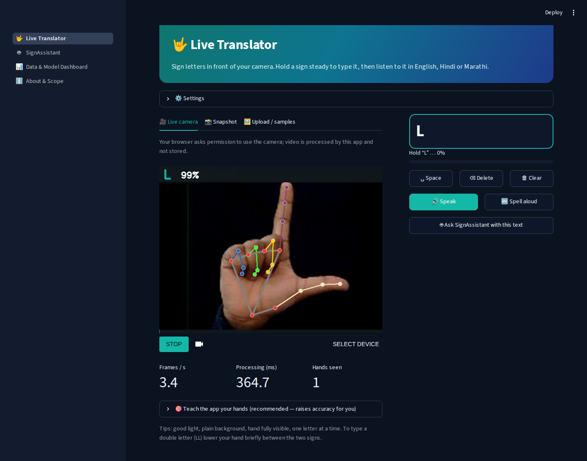
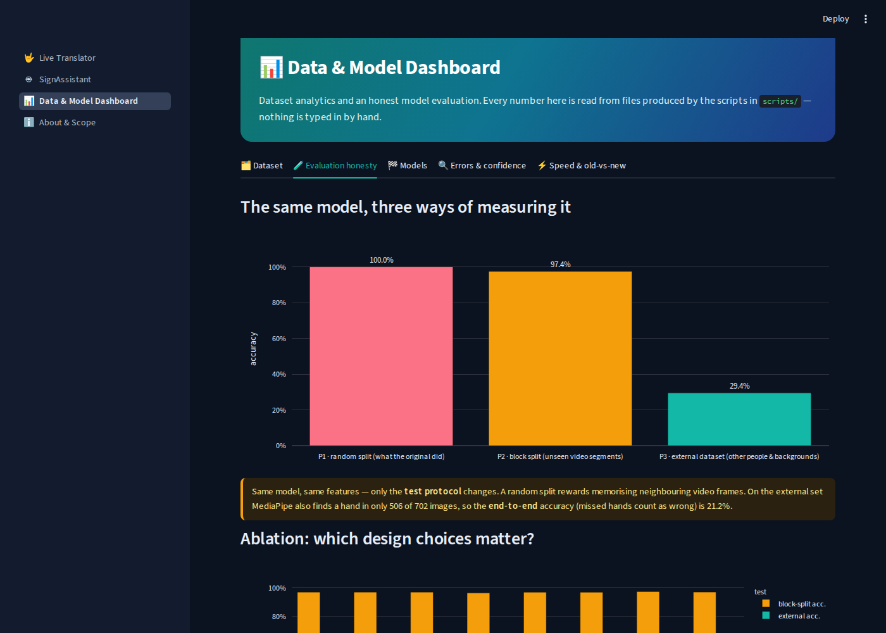
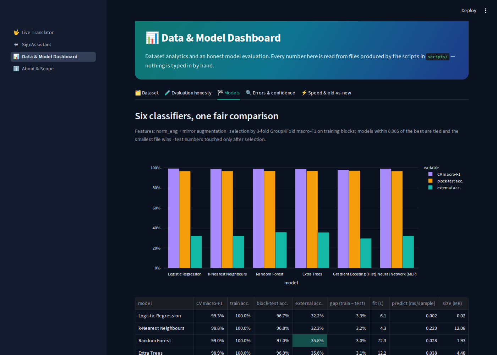
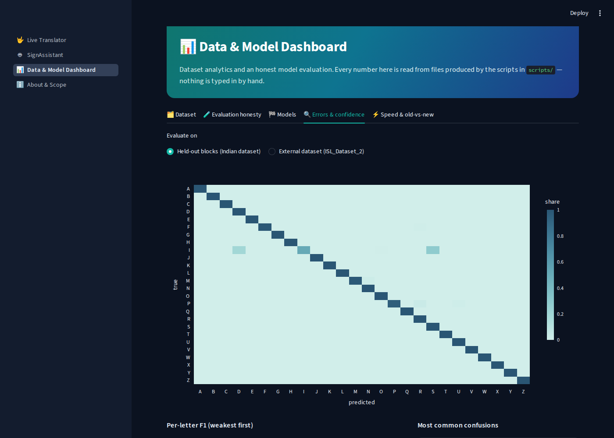
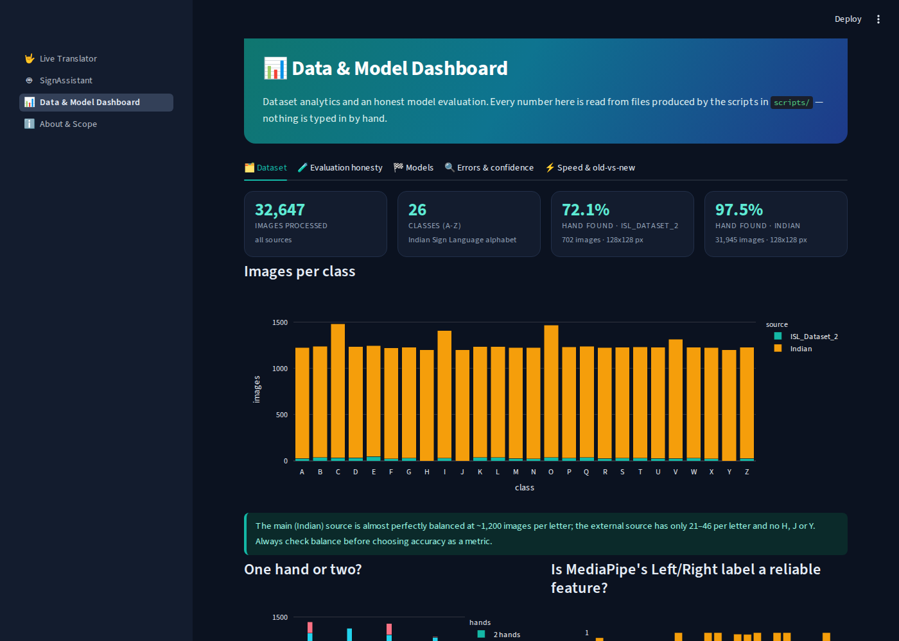
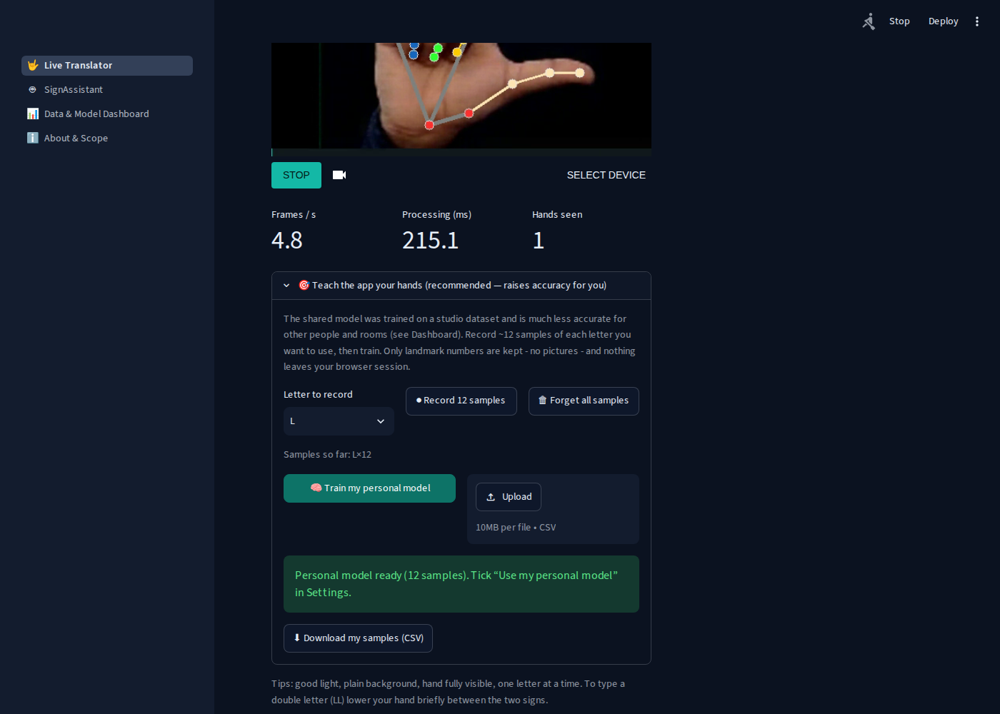
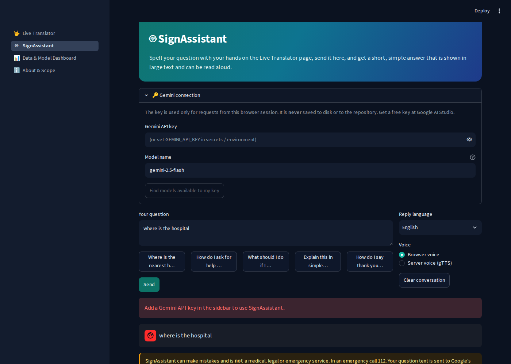

# 🤟 ISL Gesture-to-Speech

**A real-time Indian Sign Language (ISL) fingerspelling translator: camera → hand landmarks → machine-learning classifier → text → English / Hindi / Marathi → voice, with a Gemini-powered assistant and a data-science dashboard.**

[](https://github.com/Saniya1312S/isl-sign-language-app/actions)




> **Read this first (honest summary).** The classifier reaches **97.4%** accuracy on unseen video segments of its own dataset, but only
> **29.4%** on a *different* dataset (other people, hands and backgrounds). A random train/test split – what the original version of this
> project used – reports **100.0%**, which is pure memorisation of near-identical video frames. This repository therefore ships the
> *evidence* (dashboard + scripts) and a **“Teach the app your hands”** feature that lifts accuracy on a new setting (other people / backgrounds) from 32.3% to
> 56.1% using only 8 recorded examples per letter. See [Results](#6-results).

---

## Table of contents
1. [What it does](#1-what-it-does) · 2. [Screenshots](#2-screenshots) · 3. [Dataset (data card)](#3-dataset-data-card) · 4. [The ML pipeline](#4-the-ml-pipeline-step-by-step) ·
5. [Feature engineering](#5-feature-engineering) · 6. [Results](#6-results) · 7. [Why not deep learning?](#7-why-classical-ml-and-not-deep-learning) ·
8. [The app](#8-the-app-how-each-feature-works) · 9. [Run it](#9-run-it-locally-windows--macos--linux) · 10. [Deploy it](#10-deploy-free-on-streamlit-community-cloud) ·
11. [Problems found in the original project](#11-problems-found-in-the-original-project-and-how-they-were-fixed) · 12. [What was verified](#12-what-was-verified-and-what-was-not) ·
13. [Limitations & ethics](#13-limitations-and-ethics) · 14. [Repository map](#14-repository-map) · 15. [Troubleshooting](#15-troubleshooting)

---

## 1. What it does

| Feature | How |
|---|---|
| 🎥 **Live camera** recognition of the ISL alphabet (A–Z) | Browser camera (WebRTC) → MediaPipe Hands (21 landmarks per hand) → scikit-learn classifier |
| ⌨️ **Fingerspelling → text** | Smoothing + hold-time + re-arm rules (`isl/spelling.py`), word auto-complete, space / delete / clear |
| 🌐 **English → Hindi / Marathi** | Offline glossary first, then online Google Translate; says “unavailable” instead of showing fake text |
| 🔊 **Voice** | Browser speech (works offline if the voice is installed) or server voice (gTTS); “Spell aloud” reads C. A. T. |
| 🤖 **SignAssistant** | Gemini answers in ≤ 3 simple sentences. A deaf user spells a question, sends it, reads (or hears) the reply |
| 🎯 **Teach the app your hands** | Record ~12 samples per letter; a personal model is trained in seconds and used for your session |
| 📸 **Snapshot / upload** modes | Fallbacks when live video cannot connect; sample images included |
| 📊 **Data & Model dashboard** | Dataset analytics, honest evaluation, model comparison, error analysis, confidence trade-off, speed, old-vs-new |

**Scope.** Static fingerspelling of the 26 letters. Word-level and Hindi-letter recognition have a ready training pipeline
(`scripts/train_custom.py`) but **no models are shipped** (their datasets were not part of the project files). Continuous
signing / sentences / facial grammar of ISL are *not* covered. See [Limitations](#13-limitations-and-ethics).

---

## 2. Screenshots

| Dashboard – evaluation honesty | Dashboard – models |
|:-:|:-:|
|  |  |
| **Dashboard – errors & confidence** | **Dashboard – dataset** |
|  |  |
| **Teach the app your hands** | **SignAssistant** |
|  |  |

*(Screenshots are produced by `python scripts/make_screenshots.py`, which also tests every page in a real browser.)*

---

## 3. Dataset (data card)

| Source | Images | Classes | Hand found | Image size |
|---|---:|---:|---:|---|
| ISL_Dataset_2 | 702 | 23 | 72.1% | 128x128 |
| Indian | 31,945 | 26 | 97.5% | 128x128 |

* **Total: 32,647 images** processed with MediaPipe; a hand was found in **31,130** studio images and **506** external images.
  The landmark table is `data/landmarks_alphabet.csv.gz` (one row per image: source, letter, file, frame number, detected hands, 2 × 21 × 3 landmark coordinates).
  Raw images are **not** in the repository (size); the table is enough to reproduce every step from step 2 onward.
* **`Indian`** – the main dataset: 26 letters, ≈ 1,200 images each, almost perfectly balanced. Frames appear to come from short videos of a signer on a dark background, so
  **neighbouring frames are near-identical** (see below).
* **`ISL_Dataset_2`** – 702 pictures of 23 letters (no H, J, Y) with very different people, hands and (often artificial) backgrounds. Used as the **external test set**.
* A third folder in the original project (`archive (1)/Indian`, 3,846 digit images for 4 classes) is **not used**.
* **Provenance and licence: not recorded in the project files.** The folder names are all that is known. Before publishing, add the exact source
  links / citations / licences of both datasets here. Images are third-party data and are *not* covered by this repository's MIT licence.

**What the exploratory analysis found** (`scripts/eda.py`, Dashboard → Dataset):

| Finding | Evidence | Consequence |
|---|---|---|
| Neighbouring frames are near-twins | For 100% of sampled images the nearest same-letter image is ≤ 2 frames away; held-out blocks are 1.8× farther | A random split leaks → use **block** splits |
| MediaPipe's Left/Right label is not a stable feature | Same sign gets labelled both Left and Right; it also flips when the image is mirrored | Do not use it to place features |
| Many letters need two hands | About half the studio images contain two hands | The model must read both hands |
| Detection fails more on some letters / datasets | Hand found in 97.5% (studio) vs 72.1% (external); weakest letters: Q (61.8%), O (91.8%), C (91.9%) | Report *end-to-end* accuracy too |

---

## 4. The ML pipeline, step by step

```
images ──(1) extract_landmarks──▶ landmark table ──(2) eda──▶ results/eda.json
                                        │
                                  (3) train_alphabet ──▶ protocols · ablation · learning curve · 6-model comparison · final model
                                        │                    └─ (3b) adaptation_study   (4) evaluate_legacy   (5) benchmark_latency
                                        ▼
                                 models/alphabet_model.joblib  ──▶  Streamlit app  +  dashboard (reads results/*.json)
```

| Step | Command | Output |
|---|---|---|
| 1. Images → landmarks (optional, needs the image folders) | `python scripts/extract_landmarks.py --source Indian=Data/alphabet/Indian --source ISL_Dataset_2=Data/alphabet/ISL_Dataset_2` | `data/landmarks_alphabet.csv.gz` |
| 2. Exploratory data analysis | `python scripts/eda.py` | `results/eda.json`, `results/pca_sample.csv` |
| 3. Train + evaluate (all stages, ≈ 15 min on 1 CPU core) | `python scripts/train_alphabet.py --stage all` | `results/*.json`, `models/alphabet_model.joblib` |
| 3b. Few-shot personalisation study | `python scripts/adaptation_study.py` | `results/adaptation.json` |
| 4. Original vs new pipeline | `python scripts/evaluate_legacy.py` | `results/legacy_comparison.json` |
| 5. Speed benchmark | `python scripts/benchmark_latency.py` | `results/latency.json` |
| 6. Add your own words / Hindi model | `python scripts/train_custom.py --name words --folder <folder-of-class-folders>` | `models/words_model.joblib` |

Reproducibility: random seed 42 everywhere, pinned dependencies, deterministic splits. The model comparison uses **3-fold GroupKFold cross-validation on the training
blocks** for selection; test sets are only looked at afterwards.

---

## 5. Feature engineering

MediaPipe gives 21 landmarks per hand, each with (x, y, z). Up to two hands → 126 numbers. `isl/features.py` turns them into **171 features**:

| Group | Count | What it captures | Importance in the model* |
|---|---:|---|---:|
| Hand-shape coordinates | 126 | landmark positions relative to the wrist, divided by hand size | 64% |
| Fingertip distances | 30 | thumb/index/middle/ring/pinky tip → wrist, and all 10 tip-to-tip distances (per hand) | 24% |
| Finger-curl angles | 10 | bend angle of each finger (per hand) | 10% |
| Inter-hand geometry | 4 | wrist-to-wrist offset and distance (in hand sizes) | 1% |
| Number of hands | 1 | 0, 1 or 2 | <1% |

\*Mean |standardised coefficient| of the selected Logistic Regression, grouped (`final_reports.json`).

Three design decisions, each backed by an experiment:

1. **Normalise** (wrist-centred, divided by hand size) so moving or leaning towards the camera does not change the features. Unit test: shifting and shrinking a hand changes
   normalised features by < 0.001 but raw coordinates by > 0.05.
2. **Order the hands by position, not by MediaPipe's Left/Right label.** The original model collapses from 99.8% to **11.6%** accuracy when that label convention flips.
3. **Mirror augmentation** (train on x → 1 − x copies) so left-handed signers and mirrored webcams work.

**Ablation** (same Random Forest, held-out blocks vs external dataset):

| Features | Mirror augmentation | # features | Held-out blocks | External |
|---|:-:|---:|---:|---:|
| `legacy_raw126` | no | 126 | 97.0% | 16.8% |
| `legacy_raw126` | yes | 126 | 97.0% | 13.0% |
| `sorted_raw` | no | 126 | 97.0% | 18.2% |
| `sorted_raw` | yes | 126 | 96.4% | 15.6% |
| `norm` | no | 131 | 96.9% | 20.8% |
| `norm` | yes | 131 | 96.9% | 27.7% |
| `norm_eng` | no | 171 | 97.4% | 29.4% |
| `norm_eng` | yes | 171 | 97.1% | 36.0% |

Every design step improves the unseen-dataset accuracy (16.8% → 36.0%); the studio-block accuracy stays ≈ 97% throughout, which is exactly why the studio number alone cannot tell the designs apart.

---

## 6. Results

### 6.1 The same model, three ways of measuring it

| Protocol | What is held out | Accuracy |
|---|---|---:|
| **P1 – random split** (the original project's method) | random 20% of images | **100.0%** |
| **P2 – block split** | whole blocks of 200 consecutive frames, chosen inside every letter | **97.4%** (macro-F1 0.979) |
| **P3 – external dataset** | a completely different dataset (other people/backgrounds) | **29.4%**  (506 of 702 images had a detectable hand; counting missed hands as errors: **21.2%**) |

*(Random Forest, 120 trees, 15,600 images, 600 per letter; train 12,957 / test 2,643 for P2.)*

### 6.2 Six classifiers

| Model | CV macro-F1 | Held-out blocks | External | Gap (train−test) | Fit time | Size |
|---|---:|---:|---:|---:|---:|---:|
| Logistic Regression ✅ | 0.993 | 96.7% | 32.2% | 3.3% | 6 s | 0.02 MB |
| k-Nearest Neighbours | 0.988 | 96.8% | 32.2% | 3.2% | 4 s | 12.08 MB |
| Random Forest | 0.990 | 97.0% | 35.8% | 3.0% | 72 s | 1.93 MB |
| Extra Trees | 0.989 | 96.9% | 35.6% | 3.1% | 12 s | 4.48 MB |
| Gradient Boosting (Hist) | 0.981 | 97.1% | 29.6% | 2.9% | 132 s | 2.12 MB |
| Neural Network (MLP) | 0.992 | 96.7% | 32.2% | 3.3% | 27 s | 0.90 MB |

Selected by cross-validation, with a pre-declared rule: *among models within 0.005 CV macro-F1 of the best, take the smallest file.* **Logistic Regression**: CV macro-F1 0.993,
held-out blocks 96.7% (macro-F1 0.972), a **21 KB** file and 0.002 ms per prediction. All six models are close on blocks and all fail similarly on the
external data, i.e. **the data, not the algorithm, is the bottleneck.** The “Neural Network (MLP)” row is a small scikit-learn network (see [Section 7](#7-why-classical-ml-and-not-deep-learning)).

### 6.3 More studio data does not fix it – variety does

Learning curve (Dashboard → Evaluation honesty): going from 10 to 800 studio images per letter leaves the external accuracy in the 32–37% range. In contrast, a few images from the **new** setting help a lot:

| Example images per letter (from the new setting) | Accuracy on the new setting | Accuracy on studio data |
|---:|---:|---:|
| 0 | 32.3% | 96.7% |
| 1 | 41.9% | 96.6% |
| 2 | 48.5% | 98.9% |
| 3 | 49.6% | 98.9% |
| 5 | 50.8% | 97.2% |
| 8 | 56.1% | 96.2% |

Protocol: the first *k* files of each letter of the external set are the “recorded” samples, the last 50% of the files are the test set (no neighbouring files shared). The studio-data accuracy
does not degrade. This is the evidence behind the **Teach the app your hands** feature.

### 6.4 Where it makes mistakes (held-out blocks)

* Weakest letters: I (F1 0.68), S (F1 0.81), D (F1 0.86). Most frequent confusions: I→S (47), I→D (32).
* **Confidence threshold.** With the default minimum confidence of 0.60 the model answers 99.1% of frames and is right 97.6% of the time on held-out blocks. The slider on Dashboard → Errors shows the full trade-off.
* In live use a second safety net applies: a letter must win a majority vote and stay stable for 0.8 s (adjustable) before it is typed.

### 6.5 Original pipeline vs new pipeline

| Model | Test condition | Indian dataset | External dataset |
|---|---|---:|---:|
| Original (raw + Left/Right slots) | as trained (Left→slot 1, unflipped) | 99.8% | 45.3% |
| New (normalised + mirror-aug) | as trained (Left→slot 1, unflipped) | 99.3% | 32.2% |
| Original (raw + Left/Right slots) | left/right slots swapped | 11.6% | 13.2% |
| New (normalised + mirror-aug) | left/right slots swapped | 99.3% | 32.2% |
| Original (raw + Left/Right slots) | mirrored webcam frame (what the old live loop fed it) | 15.2% | 15.4% |
| New (normalised + mirror-aug) | mirrored webcam frame (what the old live loop fed it) | 99.4% | 33.2% |

The original model is excellent only under the **exact** left/right convention it was trained with, and collapses when it changes. The original Streamlit app flips the live frame before prediction (`cv2.flip`)
but – unlike the original standalone script – does not swap the slots, which is the likely reason live accuracy was poor. The new features give the same answer in all three conditions.
*Caveat:* the record of which images the original model was trained on is missing, so its external-dataset score may include images it has seen; compare only the *robustness* pattern, not the external numbers.

### 6.6 Speed

| Stage | Median time |
|---|---:|
| hand detection (MediaPipe) | 26.23 ms |
| feature building | 0.52 ms |
| classifier | 0.62 ms |
| **whole frame** | **27.7 ms** (p95 47.7 ms) |

Measured on: x86_64 · Linux · Python 3.12.3 (single process; ≈ 36 frames/s upper bound). MediaPipe hand detection is ~95% of the cost; the classifier is negligible. Your machine will differ – the Live tab shows its own frames/second and milliseconds.
Camera transport, translation and speech add network time that is not included. *Reality check:* in the real-browser test, where the browser, the Streamlit server and the WebRTC video encoder all shared **one** CPU core, the live loop ran at only ≈ 4–5 frames/s (the hold timer is in seconds, so typing still works at that speed). On a normal laptop expect much more – read the on-screen frames/s counter.

---

## 7. Why classical ML and not deep learning?

* A sign is a **single frame** described by a ~170-number vector, with 31,130 training images. For such small tabular vectors a linear model, trees and a small neural network score almost the same (Section 6.2), train in seconds on a CPU and predict in microseconds.
* **The dataset is the limit** (Section 6.3), and a deeper model would memorise it faster, not generalise better.
* The earlier report mentioned CNN-LSTM / Transformer models, MediaPipe *Holistic*, sequence windows, ONNX/TFLite export and latency metrics. **None of these existed in the code**; this README only describes what is implemented.
* Deep learning becomes the right tool for (a) learning directly from images (CNN) or (b) **moving** signs and whole sentences – a sequence model (LSTM / Transformer) over landmark frames, which also needs a sequence dataset. That is the main future-work item.

---

## 8. The app: how each feature works

**Camera (the old “camera won't open” problem).** The old app used `cv2.VideoCapture(0)`, which opens a camera on the *server*; it fails on any deployment, fails when another program holds the camera, and needed a blocking `while` loop.
The new app uses **WebRTC** (`streamlit-webrtc`): *your browser* opens *your* camera after a permission prompt and streams frames to `SignVideoProcessor`. Snapshot and Upload tabs are fall-backs.

**Spelling (`isl/spelling.py`)** – turns ~15–30 flickering predictions per second into letters:
1. *Smooth*: majority vote over the last 5 frames. 2. *Hold*: the letter must stay stable for **0.8 s** (a real-time rule, independent of frame rate). 3. *Re-arm*: the same letter can be typed again only after the hand was lowered (so `LL` in HELLO works).
Auto-complete suggests common words; **Space / Delete / Clear** edit the text. 🔊 **Speak** reads the sentence, 🔤 **Spell aloud** reads the letters.

**Voice (`isl/voice.py`).** *Browser voice* uses the Web Speech API (no server, works offline if the language voice is installed). *Server voice* uses gTTS (needs internet, reliable for Hindi/Marathi). The old `pyttsx3` speaks on the server's speakers and cannot work after deployment.

**Translation (`isl/translate.py`).** Built-in glossary of 72 everyday words (offline) → Google Translate → explicit “unavailable” message. Review the Hindi/Marathi glossary with a native speaker before real use.

**SignAssistant (`isl/assistant.py`).** Uses the current `google-genai` SDK (the old `google-generativeai` package used by the first version was retired). The API key is **never in the code**: sidebar field, `.streamlit/secrets.toml`, or the `GEMINI_API_KEY` environment variable.
Nothing is called on page load (the old app “probed” the API on every rerun); the model name is configurable because Gemini model names change; “Find models available to my key” lists them. Short answers, simple words, no medical/legal advice, 112 for emergencies. *Your question text is sent to Google.*

**Teach the app your hands (`isl/personalise.py`).** Record 12 landmark samples per letter (numbers only, no pictures) → the shipped training data + your samples (mirror-augmented, repeated ×10) → a fresh Logistic Regression in a few seconds → used for your session. Samples can be downloaded as a CSV and re-loaded.

---

## 9. Run it locally (Windows / macOS / Linux)

**Requirements:** Python **3.9 – 3.12** (MediaPipe 0.10.21 has no wheels for 3.13+), a webcam, a modern browser (Chrome/Edge recommended).

```bat
:: Windows (CMD)
git clone https://github.com/Saniya1312S/isl-sign-language-app.git
cd isl-sign-language-app
py -3.11 -m venv .venv
.venv\Scripts\activate
pip install -r requirements.txt
streamlit run app.py
```

```bash
# macOS / Linux
python3.11 -m venv .venv && source .venv/bin/activate
pip install -r requirements.txt
streamlit run app.py
```

Open http://localhost:8501 (camera access works on `localhost` without HTTPS). **Gemini (optional):** copy `.streamlit/secrets.toml.example` to `.streamlit/secrets.toml` and paste your own key, or type it in the SignAssistant page.

```bash
python -m pytest tests -q                 # 57 tests
python tests/e2e_live_browser.py          # real-browser test of the live camera page (needs: pip install playwright && playwright install chromium)
python scripts/make_screenshots.py        # tests every page in a browser and regenerates docs/screenshots
```

---

## 10. Deploy free on Streamlit Community Cloud

1. Push the repository to GitHub (see below – **never commit `secrets.toml`**).
2. https://share.streamlit.io → *New app* → repo `isl-sign-language-app`, branch `main`, main file `app.py`.
3. *Advanced settings* → **Python 3.11** → paste your secret: `GEMINI_API_KEY = "…"` (optional).
4. `packages.txt` installs the system libraries OpenCV needs (`libgl1`, `libglib2.0-0`).
5. The shared model is 21 KB, the landmark table 9 MB – well inside the free limits. *Camera note:* WebRTC uses a public STUN server; on very strict networks (some universities / mobile hotspots) a TURN server is also required – use the Snapshot tab if live video does not connect.

```bat
:: first push of this project (do NOT use --force)
git init
git add .
git commit -m "ISL Gesture-to-Speech v2: WebRTC camera, honest evaluation, dashboard, personalisation"
git branch -M main
git remote add origin https://github.com/Saniya1312S/isl-sign-language-app.git
git push -u origin main
```

---

## 11. Problems found in the original project, and how they were fixed

| # | Problem in the original code | Fix in this version |
|---|---|---|
| 1 | 🔐 A **Gemini API key was hard-coded** (and sits in the Git history of the old repo) | Key only from sidebar / secrets / env. **Revoke the old key** in Google AI Studio – deleting the file is not enough |
| 2 | `mediapipe` unpinned: a fresh install gets a version **without `mp.solutions`** → the app crashes | `mediapipe==0.10.21` pinned, Python ≤ 3.12 documented, `pip check` verified |
| 3 | Server-side `cv2.VideoCapture(0, CAP_DSHOW)` + blocking loop | Browser WebRTC camera + snapshot/upload fall-backs |
| 4 | Landmark slot chosen by MediaPipe's Left/Right label; live frame flipped without compensation → accuracy 99.8% → 15.2% in the mirrored case | Position-sorted hands, normalised features, mirror augmentation |
| 5 | One random split of near-duplicate frames (≈ 97%) | Block split + external dataset; random split reproduced only to show it (100.0%) |
| 6 | Hard-coded `D:\A_Sign\…` paths | Relative paths via `isl/config.py` |
| 7 | `pyttsx3` (server-side Windows voice) | Browser speech + gTTS |
| 8 | Deprecated `google-generativeai`, API probed on every rerun | `google-genai`, request only when you press Send, injectable client + unit tests |
| 9 | “[Translation Error]” text was spoken aloud | Explicit `unavailable` status, offline glossary |
| 10 | Words model, Hindi model and datasets referenced but missing; old Hindi path fed the *whole frame* to MobileNet | Not shipped; `train_custom.py` builds them from your folders; modes appear automatically |
| 11 | `runtime.txt` contained a requirements list; `libgl1-mesa-glx` is gone on newer Debian | `packages.txt` uses `libgl1` |
| 12 | Report claims (Holistic, CNN-LSTM/Transformer, ONNX, latency) not in the code | Removed from this README; latency is now measured |

---

## 12. What was verified, and what was not

| ✅ Verified (in the environment where this was built) | ⚠️ Not verified – please test on your side |
|---|---|
| Environment: Python 3.12, Linux, one CPU core, headless Chromium. 57 automated tests pass (features, spelling, translation, assistant with a fake client, personalisation, data integrity, model + MediaPipe integration, dashboard pages) | A **real webcam** with your hands, lighting and room (tests used a fake webcam showing sample images) |
| **Real-browser end-to-end test**: Chromium + fake webcam → WebRTC → MediaPipe → classifier → letter typed once, typed again after lowering the hand, buttons, clear | **Audio output** (browser speech and gTTS) – the code runs, but sound itself cannot be heard in a headless test |
| Every page opens without errors; sample-image recognition; recording 12 samples and training a personal model in the browser; assistant error message without a key | **Google services** (translation, gTTS, Gemini): no internet access to them here; the Gemini code is tested with a fake client only |
| `pip check` passes for the pinned `requirements.txt`; all results regenerate from the scripts | **Streamlit Community Cloud** deployment, Windows-specific behaviour, TURN/NAT cases |

Numbers in this README come from `results/*.json`, produced by the scripts above on a single CPU core.

---

## 13. Limitations and ethics

* **Dataset variety is the main limit.** One studio signer ≈ one “accent”. Expect lower accuracy than the headline block-split number for other people, rooms and cameras – use *Teach the app your hands*. The external set is small (702 images) and is itself imperfect (artificial backgrounds, 72% detection).
* **Fingerspelling is not ISL.** ISL has its own vocabulary, grammar, movement and facial expression. This tool types letters; it is **not** a substitute for a human interpreter, and has not been evaluated with deaf users.
* Letters that need motion or look alike in landmark space (here: I, S, D) are weak.
* The Hindi/Marathi glossary and Gemini answers can be wrong. Do not use the assistant for medical, legal or emergency decisions.
* **Privacy:** video frames are processed in memory and not stored. Text you choose to translate/speak/ask is sent to Google. Calibration samples are landmark numbers only.
* Consent and licences of the original image datasets are not documented – fix before any publication. Involve deaf and hard-of-hearing users and ISL experts in any real deployment.

**Future work:** sequence model for dynamic signs and words (needs a video dataset); more diverse training data; trained word/Hindi models via `train_custom.py`; confidence calibration; mobile layout; TURN server; user study.

---

## 14. Repository map

```
app.py                      Streamlit entry (4 pages)         requirements.txt   pinned dependencies
views/                      live.py · assistant_page.py · dashboard.py · about.py
isl/                        hands · features · model_io · predictor · spelling · live · translate · vocab · voice · assistant · personalise · runtime · ui
scripts/                    extract_landmarks · eda · train_alphabet · adaptation_study · evaluate_legacy · benchmark_latency · train_custom · make_screenshots
tests/                      57 pytest tests + e2e_live_browser.py (real browser)
data/                       landmarks_alphabet.csv.gz (9 MB) + data card
models/                     alphabet_model.joblib (21 KB) + metadata · legacy/ (the original model, used only for comparison)
results/                    JSON results read by the dashboard
samples/                    49 sample images (Indian_* studio, External_* other people)
docs/                       ARCHITECTURE.md · screenshots/
.github/workflows/ci.yml    runs the tests on every push
```

Full design notes: [`docs/ARCHITECTURE.md`](docs/ARCHITECTURE.md) · data card: [`data/README.md`](data/README.md) · model card: [`models/README.md`](models/README.md).

---

## 15. Troubleshooting

| Problem | Fix |
|---|---|
| `AttributeError: module 'mediapipe' has no attribute 'solutions'` | Install the pinned version: `pip install mediapipe==0.10.21` (needs Python ≤ 3.12) |
| `pip` cannot find `mediapipe==0.10.21` | You are on Python 3.13+. Create the venv with Python 3.11 or 3.12 |
| Camera permission prompt never appears / video stays black | Use `http://localhost:8501` or HTTPS; allow the camera in the browser address bar; close other programs using the camera; try the **Snapshot** tab |
| Live video “connecting…” forever (deployed) | Strict network – use Snapshot, or configure a TURN server |
| Nothing is typed | Hold the sign steady for the hold time (Settings), improve light, lower *Minimum confidence*, or use **Teach the app your hands** |
| No sound | Switch *Voice engine* (browser ↔ server). Hindi/Marathi browser voices may not be installed → use server voice (needs internet) |
| “API key was rejected” / “model not available” | Check the key; use *Find models available to my key* and paste a listed name |
| `ModuleNotFoundError: isl` | Run commands from the repository root |
| scikit-learn version warning when loading the model | Run `python scripts/train_alphabet.py --stage final` to re-create it |

---

*Built as a B.Tech (AI & Data Science) major project; see `docs/ARCHITECTURE.md` for design rationale. Code: MIT (see `LICENSE`). Third-party data and libraries keep their own licences: MediaPipe (Apache-2.0), scikit-learn (BSD-3), Streamlit (Apache-2.0).*
