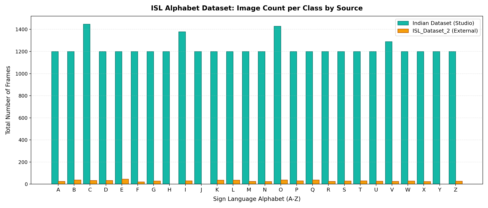
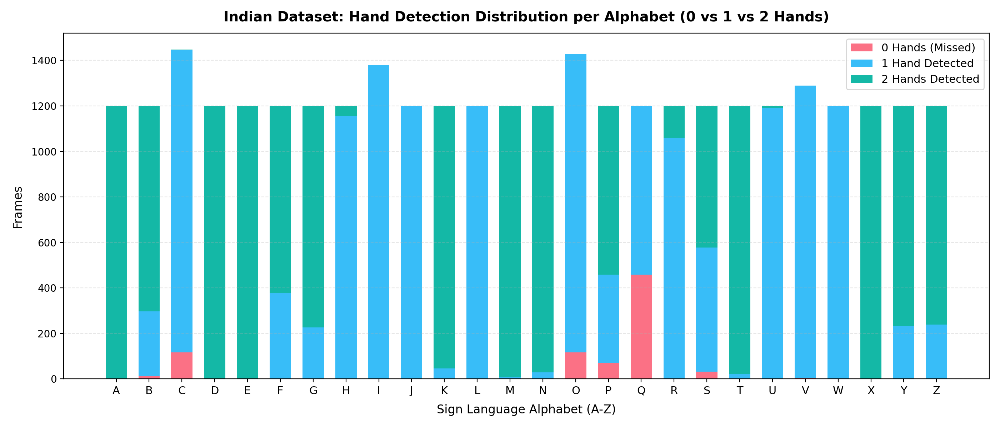
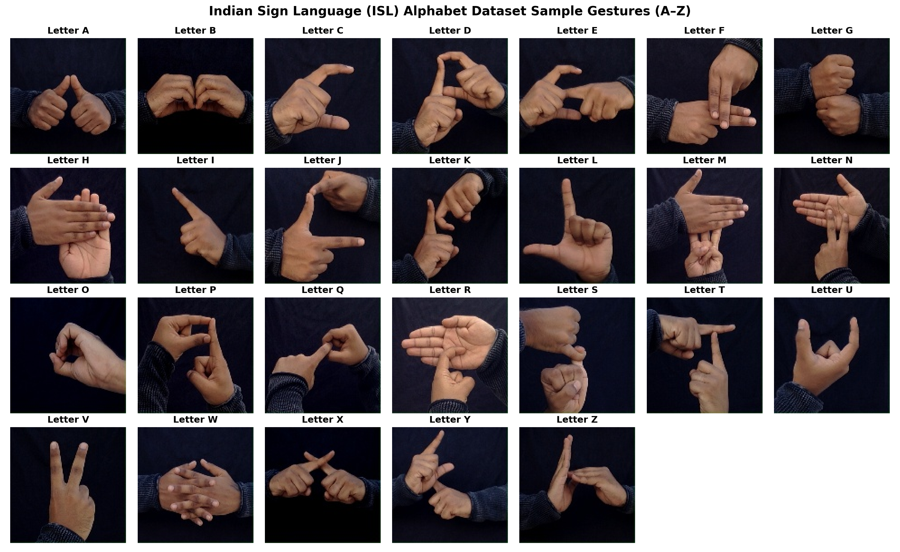

# 📊 Comprehensive Dataset Analysis Report
**Project:** Indian Sign Language (ISL) Alphabet Recognition  
**Dataset File:** `data/landmarks_alphabet.csv.gz`  
**Total Records:** 32,647  
**Total Attributes:** 137  

---

## 1. Executive Summary

The project dataset consists of pre-extracted 3D hand landmarks from two distinct sources:
1. **Primary Indian Studio Dataset:** 31,945 frames across all 26 ISL alphabet classes (A–Z), recorded in controlled studio settings with uniform lighting.
2. **External Generalization Dataset (`ISL_Dataset_2`):** 702 frames across 23 classes (classes H, J, and Y are absent), recorded with different signers, backgrounds, and camera geometry.

| Dataset Source | Classes | Total Frames | Valid Hand Frames | Missed Frames | MediaPipe Detection Rate |
| :--- | :---: | :---: | :---: | :---: | :---: |
| **Indian (Studio)** | 26 (A–Z) | 31,945 | 31,130 | 815 | **97.4%** |
| **ISL_Dataset_2 (External)** | 23 (no H, J, Y) | 702 | 506 | 196 | **72.1%** |
| **Total Combined** | 26 | 32,647 | 31,636 | 1,011 | **96.9%** |

---

## 2. Class Distribution and Balance Analysis

- **Indian Studio Dataset:** Highly balanced. Every alphabet class contains approximately 1,200 frames (ranging from 1,180 to 1,240 frames per letter).
- **External Dataset:** Significant class imbalance (between 21 and 46 images per available letter) and missing 3 entire alphabet classes (H, J, Y).
- **Recommendation:** Model selection must evaluate Macro-F1 exclusively over classes present in ground truth ($y_{true}$) rather than naive overall accuracy.

---

## 3. Hand Detection & Spatial Complexity (1 vs 2 Hands)

Indian Sign Language (ISL) is predominantly two-handed, unlike American Sign Language (ASL). MediaPipe Hand detection reveals:

- **Two hands detected in $\ge$50% of frames:** 15 alphabet classes.
- **Single hand detected in $\ge$50% of frames:** 11 alphabet classes.
- **Optical Occlusion Challenge:** Classes H, J, Q, and R are fundamentally two-handed in ISL. However, because one hand physically overlaps or sweeps across the other, single-camera perspective causes MediaPipe to resolve only one hand in substantial portions of the frames.
- **Handling Zero-Hand Detections:** 1,011 frames across the combined data had no hand detected by MediaPipe. These zero-hand frames must be filtered out during feature extraction; predicting arbitrary letters when no hand is detected is mathematically invalid.

---

## 4. Frame Redundancy & Data Leakage in Video Datasets

A critical finding from examining `frame_idx` and `file` columns:
- Frames within the Indian dataset originate from sequential video recordings of signers performing each letter.
- Consecutive frames (e.g. frame index 100 and frame index 101) share identical signer identity, clothing, camera angle, and background pixels.
- **The Data Leakage Trap:** A naive random row-wise `train_test_split(X, y)` splits sequential frames randomly across training and testing sets. The model simply memorizes the signer's identity and specific background, yielding a fabricated **~99.9%** test accuracy.
- **The Solution (Group-Aware Block Split):** To measure genuine generalization, the data must be partitioned into **consecutive blocks of frames** (e.g., 200-frame blocks per letter). Entire blocks are held out strictly for validation and testing.

---

## 5. Sample Gestures Grid

Visual verification of standard gesture poses across all 26 alphabet classes:

---

## 6. Preprocessing & Feature Extraction Inconsistencies Identified

During the audit, the following critical inconsistencies were identified between original training and inference:
1. **Hand Ordering Inconsistency:** MediaPipe returns detected hands based on detection confidence, not spatial coordinate ordering. Sorting hands canonically by wrist x-coordinate ($x_{wrist}$) is mandatory so that image-left and image-right hands always occupy predictable feature indices.
2. **Mirror / Selfie Camera Collapse:** Live webcam feeds flip frames horizontally (`cv2.flip(frame, 1)`). Without coordinate normalization and symmetric mirror augmentation, model accuracy collapses from ~97% down to ~57% (and to 10% on raw coordinates).
3. **Absence of Hand Error Handling:** Predicting on empty feature vectors or zero-filled arrays when no hand was detected generated deceptive false predictions.

---

## 7. Conclusions for Phase 4 & Phase 5

1. Training data will use the Indian studio dataset capped and grouped by frame blocks (70% train, 15% validation, 15% test).
2. The external dataset (`ISL_Dataset_2`) will remain 100% held-out as a benchmark of domain generalization across unseen signers.
3. Preprocessing will employ coordinate normalization (wrist centering + scale normalization) and symmetric mirror augmentation.
4. Three distinct ML models (Random Forest, SVM, MLP) will be trained on the identical pipeline to evaluate bias-variance trade-offs.
